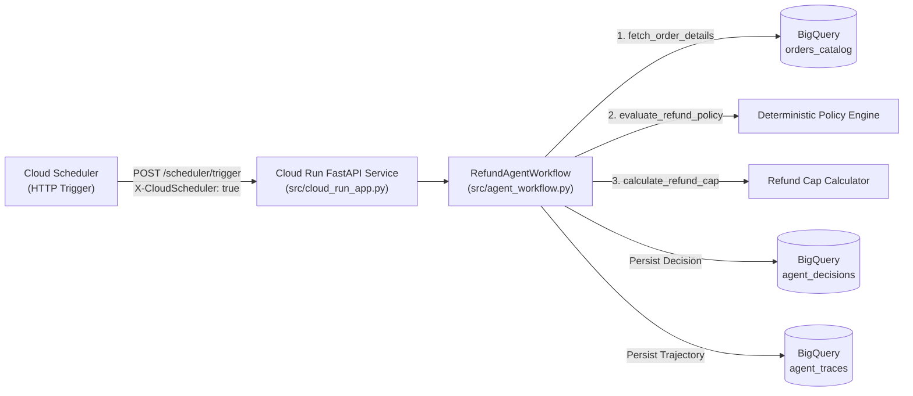

# GCP Agentic AI QA Lab (`Cloud Scheduler -> Cloud Run -> BigQuery`)

Hands-on Quality Assurance engineering repository designed for the **QA Engineer – AI with GCP** role. It simulates an end-to-end serverless **Agentic AI Order Refund & Triage Pipeline** on Google Cloud Platform and validates it across four testing pillars:

1. **API & Cloud Scheduler Contract Testing** ([`tests/test_01_api_and_scheduler.py`](./tests/test_01_api_and_scheduler.py))
2. **Agentic AI Tool Trajectory & Anti-Hallucination Testing** ([`tests/test_02_agentic_workflow.py`](./tests/test_02_agentic_workflow.py))
3. **BigQuery Cross-Dataset SQL Reconciliation** ([`tests/test_03_bigquery_reconciliation.py`](./tests/test_03_bigquery_reconciliation.py))
4. **AI-Assisted Test Generation & Human-in-the-Loop (HITL) Governance** ([`tests/test_04_ai_test_generation_hitl.py`](./tests/test_04_ai_test_generation_hitl.py))

---

## Architecture Overview



---

## Quickstart (Zero-Docker Local Mode)

```bash
# 1. Create and activate a lightweight virtual environment (~35 MB)
python3 -m venv .venv
.venv/bin/pip install -r requirements.txt

# 2. Run the full automated QA suite (all 4 pillars)
.venv/bin/pytest -v

# 3. Run the interactive Fault-Injection & Root Cause Analysis (RCA) demo
.venv/bin/python -m src.rca_demo
```

---

## Repository Structure & Documentation

- [`AGENTS.md`](./AGENTS.md): Workspace governance rules (including the mandatory English-only repository rule and QA standards).
- [`.agents/skills/`](./.agents/skills/): On-demand Antigravity skills (`agentic-workflow-eval`, `bigquery-data-reconciliation`, `ai-testgen-hitl`).
- [`.agents/agents/`](./.agents/agents/): Specialized QA agents (`agentic-qa-auditor`, `bq-reconciliation-specialist`, `hitl-test-architect`).
- [`docs/interview_guide_qa_ai_gcp.md`](./docs/interview_guide_qa_ai_gcp.md): Rapid-fire interview guide with the top 12 technical questions and model answers.
- [`docs/step_by_step_tutorial.md`](./docs/step_by_step_tutorial.md): Step-by-step hands-on walkthrough of every module and test suite.
- [`docs/process_and_architecture_log.md`](./docs/process_and_architecture_log.md): Full engineering & QA process log from JD deconstruction to RCA verification.
- [`docs/local_floci_gcp_setup.md`](./docs/local_floci_gcp_setup.md): Optional guide for connecting `HybridBigQueryStorage` to Floci Docker or real GCP.

