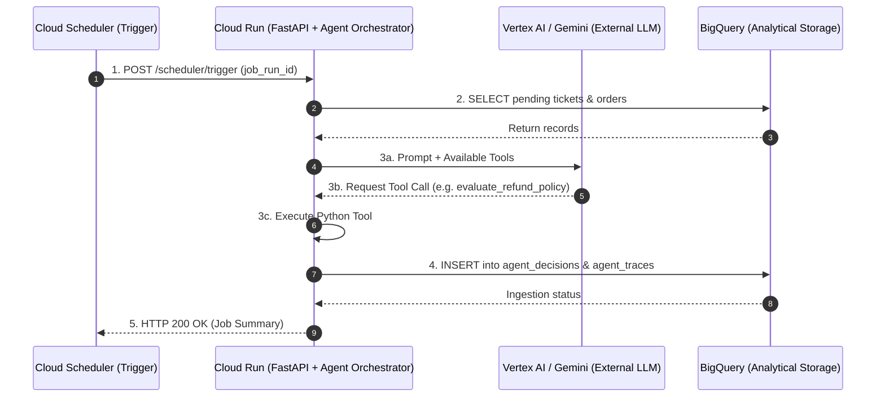

# End-to-End Engineering & QA Process Log

This document chronicles the complete design, initialization, architecture decisions, customization setup, and validation strategy implemented in this repository for the **QA Engineer – AI with GCP** role.

---

## 1. Job Description Deconstruction & QA Strategy Mapping

We analyzed the target Job Description (**QA Engineer – AI with GCP**) and mapped every responsibility and required skill to an executable module and verification suite:

| JD Requirement / Responsibility | Repository Implementation | Verification Suite |
| :--- | :--- | :--- |
| **Test Agentic AI workflows & validate AI-generated outputs** | [`src/agent_workflow.py`](../src/agent_workflow.py) (`RefundAgentWorkflow` + `audit_agent_evaluation`) | [`tests/test_02_agentic_workflow.py`](../tests/test_02_agentic_workflow.py) |
| **Work with GCP services: Cloud Scheduler, Cloud Run, BigQuery** | [`src/cloud_run_app.py`](../src/cloud_run_app.py) & [`src/bq_storage.py`](../src/bq_storage.py) | [`tests/test_01_api_and_scheduler.py`](../tests/test_01_api_and_scheduler.py) |
| **Validate data accuracy & consistency across multiple datasets; investigate discrepancies** | Cross-table SQL reconciliation across `orders_catalog`, `raw_tickets`, `agent_decisions`, and `agent_traces` | [`tests/test_03_bigquery_reconciliation.py`](../tests/test_03_bigquery_reconciliation.py) |
| **Use AI tools to generate test cases/plans & implement Human-in-the-Loop (HITL) review** | [`src/qa_ai_generator.py`](../src/qa_ai_generator.py) (`AITestGenerator`, `validate_ai_candidate`, `HumanReviewGate`) | [`tests/test_04_ai_test_generation_hitl.py`](../tests/test_04_ai_test_generation_hitl.py) |
| **Identify defects, perform Root Cause Analysis (RCA), and document results** | Controlled `fault_mode` injection (`hallucination`, `skipped_tool`, `data_discrepancy`) + automated RCA runner | [`src/rca_demo.py`](../src/rca_demo.py) |

---

## 2. Repository Initialization & Antigravity Workspace Customizations

To make this repository a self-contained, AI-first engineering workspace, we initialized Git and configured Antigravity customizations at the root of the project:

1. **Workspace Rules ([`AGENTS.md`](../AGENTS.md))**:
   - Enforces a **Strict English-Only Repository Policy**: every code file, docstring, test, skill, agent definition, and markdown document in the repository is authored in English regardless of the conversational language used in chat.
   - Establishes architectural invariants and the 4 mandatory QA pillars.
2. **On-Demand Procedural Skills (`.agents/skills/`)**:
   - [`agentic-workflow-eval`](../.agents/skills/agentic-workflow-eval/SKILL.md): Runbook for evaluating tool trajectories, groundedness, and fault-injection modes.
   - [`bigquery-data-reconciliation`](../.agents/skills/bigquery-data-reconciliation/SKILL.md): Runbook and Standard SQL queries for cross-dataset reconciliation.
   - [`ai-testgen-hitl`](../.agents/skills/ai-testgen-hitl/SKILL.md): Runbook for AI test generation and human review gate governance.
3. **Specialized Workspace Agents (`.agents/agents/`)**:
   - [`agentic-qa-auditor.md`](../.agents/agents/agentic-qa-auditor.md)
   - [`bq-reconciliation-specialist.md`](../.agents/agents/bq-reconciliation-specialist.md)
   - [`hitl-test-architect.md`](../.agents/agents/hitl-test-architect.md)

---

## 3. Architecture Decision Record (ADR): Hybrid Local-First Execution

### Context
Running full Docker emulators (such as `floci/floci-gcp` or `bigquery-emulator`) requires downloading 250 MB–600 MB container images (~1 GB uncompressed on disk) and running a local Docker daemon.

### Decision
We implemented [`HybridBigQueryStorage`](../src/bq_storage.py) supporting two modes via `BQ_MODE`:
- **`BQ_MODE=local` (Default)**: Uses Python's built-in `sqlite3` analytical engine in memory. It requires **zero Docker downloads**, installs in seconds (~35 MB `.venv`), and executes all 16 automated tests in under `0.5s`.
- **`BQ_MODE=floci` / `BQ_MODE=gcp` (Optional)**: Lazy-loads `google-cloud-bigquery` only when explicitly requested, allowing seamless transition to a local Docker emulator (`http://localhost:4588`, documented in [`docs/local_floci_gcp_setup.md`](./local_floci_gcp_setup.md)) or a real Google Cloud project.

---

## 4. Fault-Injection Matrix & Root Cause Analysis (RCA) Playbook

To prove that our QA automation detects real-world AI and data pipeline defects, [`RefundAgentWorkflow.evaluate_ticket()`](../src/agent_workflow.py) supports four execution modes:

| Fault Mode | Simulated Production Defect | How QA Detects It | Root Cause Classification |
| :--- | :--- | :--- | :--- |
| `normal` | None (healthy baseline execution) | All trajectory, groundedness, and SQL reconciliation checks pass | N/A |
| `hallucination` | Agent ignores `calculate_refund_cap` output and approves `$500.00` on a `$120.00` order | `audit_agent_evaluation` flags `HALLUCINATION_DEFECT`; BigQuery SQL flags `OVER_REFUND_EXCEEDS_ORDER_TOTAL` | LLM Faithfulness / Missing Post-Generation Guardrail |
| `skipped_tool` | Agent approves a refund directly after `fetch_order_details` without calling `evaluate_refund_policy` | `audit_agent_evaluation` flags `SKIPPED_TOOL_DEFECT` | Agent Orchestration / Prompt Drift |
| `data_discrepancy` | Persistence layer inserts duplicate decision rows and drops `agent_traces` records | BigQuery SQL reconciliation flags `duplicate_decisions` and `decisions_missing_traces` | Data Pipeline / Storage Adapter Bug |

---

## 5. AI-Assisted Test Generation & Human-in-the-Loop (HITL) Process

Implemented in [`src/qa_ai_generator.py`](../src/qa_ai_generator.py):

1. **Specification Baseline**: 5 core requirements (`REQ-001` through `REQ-005`).
2. **Candidate Generation**: `AITestGenerator` produces 6 candidate test cases (`AI-TC-001`..`AI-TC-006`).
3. **Automated Static Pre-Screening (`validate_ai_candidate`)**:
   - Automatically flags `AI-TC-004` for a `CONTRADICTORY_ORACLE` (`expected_status="ESCALATED_TO_HUMAN"` paired with `expected_max_refund=1500.0`).
   - Automatically flags `AI-TC-006` for `UNKNOWN_REQUIREMENT` (`REQ-999`) and `MISSING_TOOL_ASSERTIONS`.
4. **Human Review Gate (`HumanReviewGate`)**:
   - Blocks execution if any test case is in `PENDING_REVIEW` or if a reviewer tries to approve a test case with unresolved validation warnings.
   - Records `APPROVED` (`AI-TC-001`, `AI-TC-002`, `AI-TC-003`, `AI-TC-005`), `EDITED_BY_HUMAN` (`AI-TC-004` after fixing `expected_max_refund=0.0`), and `REJECTED` (`AI-TC-006`).
5. **Coverage & Live Execution**: Confirms `100.0%` requirement coverage across `REQ-001`..`REQ-005` and executes the 5 validated test cases against the FastAPI Cloud Run service.

---

## 6. Deep Dive: GCP Serverless Triad Lifecycle & Failure Modes

This section documents the architectural relationship between **Cloud Scheduler**, **Cloud Run**, and **BigQuery**, clarifying where the agent lives, the 5-step lifecycle, and the three critical failure points tested in this project.

### 6.1 The Serverless Triad Roles
- **Cloud Scheduler ("The Trigger / Clock")**: A serverless cron service that initiates batch jobs via HTTPS requests. It carries trigger metadata (e.g., `X-CloudScheduler: true`, `X-CloudScheduler-JobName`) and guarantees *at-least-once delivery*.
- **Cloud Run ("The Brain / Compute Container")**: A serverless containerized execution environment hosting the FastAPI application, the Agentic Orchestrator, the deterministic tool implementations, and data transformation logic.
- **BigQuery ("The Memory / Analytical Warehouse")**: High-performance analytical storage acting as both the **source** (retrieving pending tickets and catalog orders) and the **destination** (persisting decisions and tool audit trajectories).

### 6.2 Where Does the Agent Live?
A common architectural misconception is assuming the entire LLM lives inside Cloud Run. In production GCP architectures:
- **Inside Cloud Run (Microservice Container)**:
  1. The **Agent Orchestrator** ([`src/agent_workflow.py`](../src/agent_workflow.py)): Manages execution flow, calls tools, and tracks state.
  2. The **Deterministic Business Tools** (`fetch_order_details`, `evaluate_refund_policy`, `calculate_refund_cap`): Real Python functions connecting to databases and business logic.
  3. **Guardrails & Persistence Adapters**: Schema validators, financial caps, and BigQuery connectors.
- **Outside Cloud Run (Managed GCP AI Services)**:
  - The foundation model (e.g., **Gemini 1.5 Pro on Vertex AI**). Cloud Run sends HTTPS/gRPC requests with prompt instructions and tool definitions; Vertex AI returns structured tool calls (`"call evaluate_refund_policy with args..."`).

### 6.3 The Complete 5-Step Lifecycle
The pipeline does not terminate upon reading from BigQuery; it completes a full round-trip:
1. **Trigger**: Cloud Scheduler sends `POST /scheduler/trigger` with `job_run_id`.
2. **Context Retrieval (Read)**: Cloud Run queries BigQuery (`SELECT` from `raw_tickets` and `orders_catalog`).
3. **Agentic Reasoning & Tool Execution**: Cloud Run orchestrates tool calls, checking policies and computing refund caps.
4. **Analytical Persistence (Write - Crucial Step)**: Cloud Run writes structured outcomes into `agent_decisions` and granular tool invocation steps into `agent_traces`.
5. **Lifecycle Acknowledgment**: Cloud Run returns `HTTP 200 OK` (with `processed_count`) to Cloud Scheduler.



### 6.4 The Three Critical Failure Points & QA Mitigation

#### 1. BigQuery Write Failure & Silent HTTP 200s (Step 4 Failure)
- **Defect**: BigQuery streaming inserts (`insert_rows_json()`) return a list of row-level errors instead of raising an HTTP exception. If unhandled, Cloud Run mistakenly returns `HTTP 200 OK`, causing silent data loss.
- **QA Strategy**:
  - Test HTTP error contracts: verify that write errors trigger `HTTP 500` or logged alerts.
  - SQL Completeness Reconciliation:
    ```sql
    SELECT r.ticket_id FROM raw_tickets r
    LEFT JOIN agent_decisions d ON r.ticket_id = d.ticket_id
    WHERE d.ticket_id IS NULL;
    ```

#### 2. Partial Writes / Lost Audit Trajectory
- **Defect**: The service persists the decision to `agent_decisions` but fails before writing to `agent_traces`, leaving high-stakes AI decisions without auditable tool trajectory logs.
- **QA Strategy**:
  - Orphan records SQL check:
    ```sql
    SELECT d.ticket_id, d.status, COUNT(t.trace_id) AS trace_steps
    FROM agent_decisions d
    LEFT JOIN agent_traces t ON d.ticket_id = t.ticket_id
    GROUP BY d.ticket_id, d.status
    HAVING COUNT(t.trace_id) = 0;
    ```

#### 3. Cloud Scheduler Retries & Duplicate Decisions
- **Defect**: Cloud Scheduler retries on cold starts or network timeouts. Without idempotency, duplicate decisions and multiple refund records are inserted into BigQuery.
- **QA Strategy**:
  - Validate idempotency keys: Cloud Run checks `has_processed_job_run(job_run_id)` and returns `idempotent_skip: true`.
  - SQL Uniqueness Reconciliation:
    ```sql
    SELECT ticket_id, COUNT(*) AS decision_count
    FROM agent_decisions
    GROUP BY ticket_id
    HAVING COUNT(*) > 1;
    ```

### 6.5 Terminal Warnings vs. Intentional QA Faults
- **Deprecation Warning (`StarletteDeprecationWarning`)**: A non-blocking library warning regarding `httpx` in the test client. All 17 unit/integration tests pass cleanly.
- **RCA Demo Output (`python -m src.rca_demo`)**: Displays intentional negative fault-injection scenarios (`hallucination`, `skipped_tool`, `data_discrepancy`) designed to demonstrate that our QA assertion layer and SQL reconciliation queries immediately flag and diagnose production defects.


